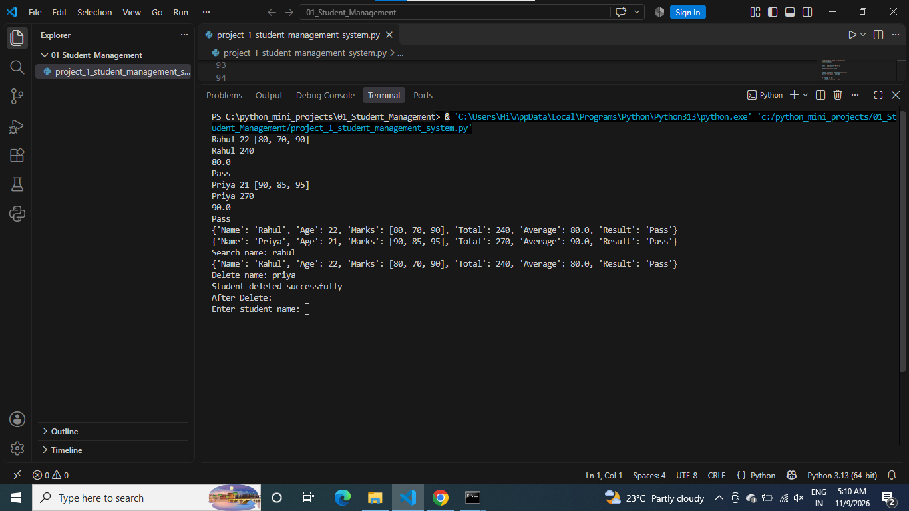

# Student Management System

## About the Project
This is a Python-based Student Management System.

## Features
- Add Student
- View Students
- Search Student
- Update Student Details
- Delete Student

## Technologies Used
- Python
- Functions
- Lists and Dictionaries
- Loops
- Conditional Statements

## How to Run
python project_1_student_management_system.py

## Output Screenshot

