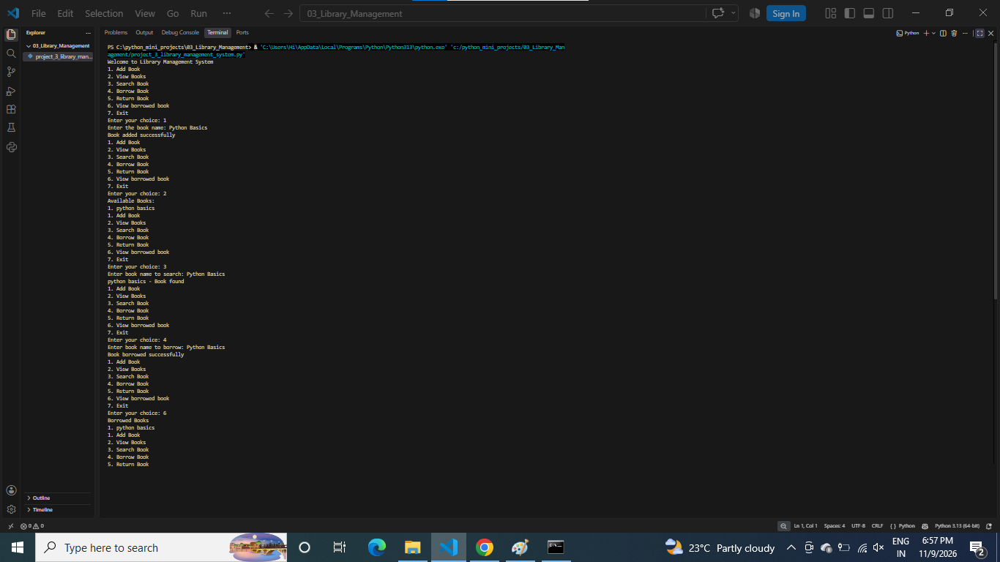

# Library Management System

## About the Project
This is a Python-based Library Management System.

## Features
- Add Books
- View Available Books
- Search Books
- Issue Books
- Return Books
- Manage Book Records

## Technologies Used
- Python
- Functions
- Lists
- Dictionaries
- Loops
- Conditional Statements

## How to Run
python project_3_library_management_system.py

## Output Screenshot

