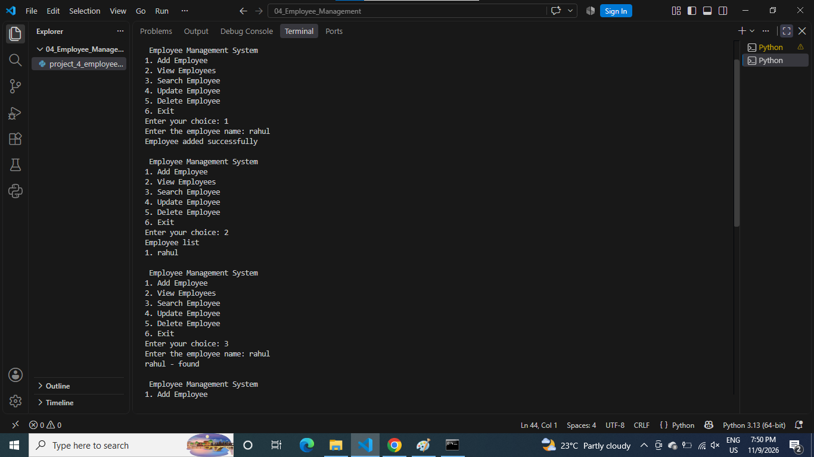
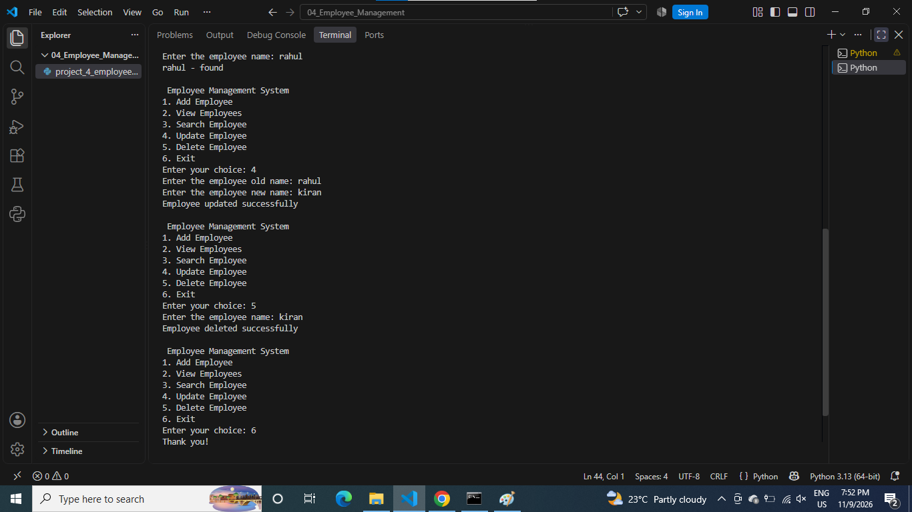

# Employee Management System

## About the Project
This is a Python-based Employee Management System.

## Features
- Add Employee
- View Employees
- Search Employee
- Update Employee Details
- Delete Employee
- Manage Employee Records

## Technologies Used
- Python
- Functions
- Lists
- Dictionaries
- Loops
- Conditional Statements

## How to Run
python project_4_employee_management_system.py

## Output Screenshots

### Screenshot 1

### Screenshot 2

