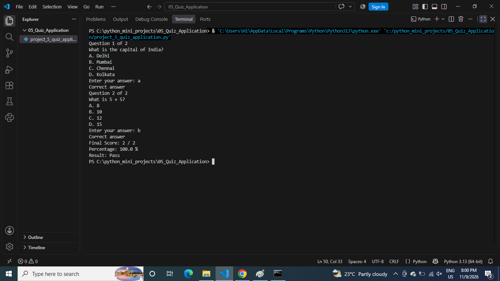

# Quiz Application

## About the Project
This is a Python-based Quiz Application.

## Features
- Display Quiz Questions
- Multiple Choice Answers
- Check Correct Answers
- Calculate Final Score
- Display Quiz Results

## Technologies Used
- Python
- Functions
- Lists
- Dictionaries
- Loops
- Conditional Statements

## How to Run
python project_5_quiz_application.py

## Output Screenshot

