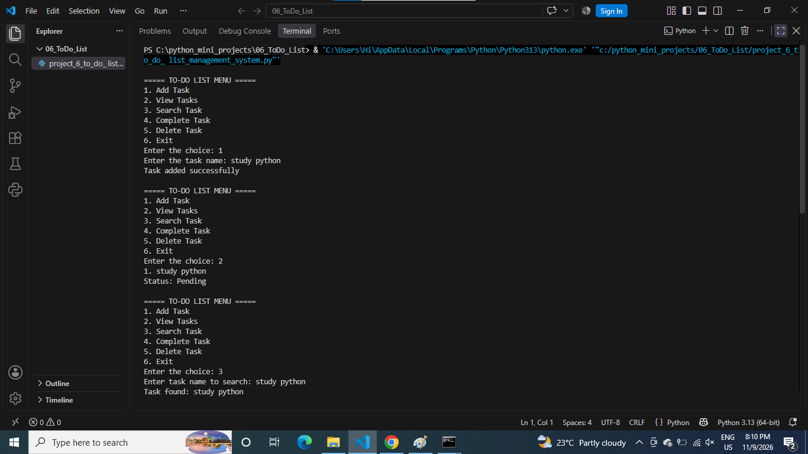
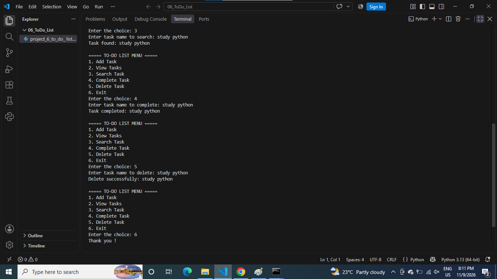

# To-Do List Management System

## About the Project
This is a Python-based To-Do List Management System.

## Features
- Add Tasks
- View All Tasks
- Update Tasks
- Delete Tasks
- Mark Tasks as Completed
- Manage Daily Tasks

## Technologies Used
- Python
- Functions
- Lists
- Dictionaries
- Loops
- Conditional Statements

## How to Run
python project_6_to_do_ list_management_system.py

## Output Screenshots

### Screenshot 1

### Screenshot 2

